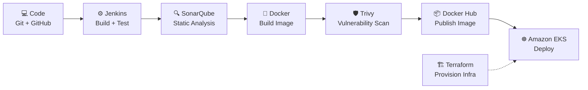

<!-- ================================================================ -->
<!--  OM KUTE • CLOUDOPS / DEVOPS ENGINEER • GITHUB PROFILE            -->
<!--  Search for "EDIT:" to find the few spots to personalise.         -->
<!-- ================================================================ -->

 

  

 

## 🚀 Overview

Entry-level **CloudOps / DevOps Engineer** with **8 months of hands-on internship experience** across **AWS, Linux administration, Terraform, Docker, Kubernetes and CI/CD automation**.
I built a **Jenkins pipeline that ships containerised apps to Amazon EKS** with **SonarQube** and **Trivy** security scanning, and I'm comfortable following SOPs, troubleshooting, and supporting production operations.

**Goal:** grow into a **CloudOps Engineer** role and build a long-term career in **AWS Cloud and SRE**.

| 🧑‍💻 Experience | 🎓 Education | 🏅 Credentials | 🎯 Targeting |
|:---:|:---:|:---:|:---:|
| **8 months** DevOps Intern | **B.Tech 2026** Computer Engineering | **2 AWS Academy** badges on Credly | **CloudOps · DevOps** AWS · SRE path |

---

## 🔁 Pipeline I Built

Cloud-Native CI/CD Pipeline with Kubernetes: infrastructure provisioned by Terraform, deployments automated from Jenkins.

---

## 💼 Experience

<table>
<tr>
<td width="22%" valign="top">

**DevOps Engineer Intern** 
Hisan Labs Pvt. Ltd. 
`Mar 2026 – Nov 2026`

</td>
<td width="78%" valign="top">

- ☁️ Provisioned and managed **AWS infrastructure with Terraform (IaC)** for application deployment and hosting
- 🔐 Used **EC2, S3, IAM and VPC** for infrastructure setup, access control and application hosting
- 🐧 Administered **Linux (Ubuntu)** environments: process management, file permissions, command-line troubleshooting, Bash scripting
- ☸️ Deployed containerised apps with **Docker and Kubernetes** (Deployments, Services, Ingress, ConfigMaps, Secrets)
- ⚙️ Supported **CI/CD workflows** and deployment automation with Git, GitHub and Jenkins

</td>
</tr>
</table>

---

## ⚙️ Tech Stack

 

 

| Category | Skills |
|---|---|
| ☁️ **Cloud (AWS)** | EC2 · S3 · RDS · CloudWatch · Lambda · IAM · VPC · EKS · DynamoDB · Route 53 · CloudFormation · EBS · EFS · ELB · CloudFront   *Working knowledge:* Microsoft Azure, Google Cloud Platform |
| 🏗️ **Infrastructure as Code** | Terraform · AWS CloudFormation · Ansible |
| 🐳 **Containers & Orchestration** | Docker · Docker Compose · Kubernetes · Amazon EKS (Pods, Deployments, Services, Ingress, ConfigMaps, Secrets, Namespaces) |
| 🔁 **CI/CD & Version Control** | Jenkins · GitHub Actions · Deployment Automation · Git · GitHub |
| 🛡️ **DevSecOps** | SonarQube (static code analysis) · Trivy (container vulnerability scanning) |
| 🐧 **Linux & OS** | Ubuntu · process management · file permissions · user management · CLI troubleshooting · Windows |
| 📡 **Monitoring** | AWS CloudWatch: metrics, logs, alarms |
| 🌐 **Networking** | TCP/IP · DNS · DHCP · HTTP/HTTPS · SSH · Subnetting · VPC · Security Groups · Load Balancing |
| 🗄️ **Databases** | SQL · MySQL · MariaDB · MongoDB · Amazon RDS · DynamoDB |
| 💻 **Scripting** | Python · Shell · Bash · Java |

---

## 🧪 Featured Projects

<!-- EDIT: replace the repo names below with your real repository names so the pin cards load. -->

 

<b>☸️ Cloud-Native CI/CD Pipeline with Kubernetes</b> &nbsp; <code>Jenkins</code> <code>Terraform</code> <code>EKS</code> <code>Docker</code> <code>SonarQube</code> <code>Trivy</code>

 

- Designed and built a **Jenkins CI/CD pipeline** that automates application build, test and deployment
- Provisioned cloud infrastructure with **Terraform** and automated deployment to **Amazon EKS** from the pipeline
- Containerised applications with **Docker** and published images to **Docker Hub**
- Integrated **SonarQube** static code analysis and **Trivy** vulnerability scanning (DevSecOps)

<b>Stack:</b> Jenkins · Git · GitHub · Docker · Kubernetes · AWS EKS · Terraform · SonarQube · Trivy · Linux

<b>⚡ AWS Serverless Event Processing Pipeline</b> &nbsp; <code>Lambda</code> <code>DynamoDB</code> <code>Event-Driven</code>

 

- Developed an **event-driven serverless architecture** using **AWS Lambda and DynamoDB** for automated event processing
- Reduced infrastructure management overhead by using **managed, scalable AWS services** instead of servers

<b>Stack:</b> AWS Lambda · DynamoDB · Serverless Architecture · Event-Driven Architecture

<b>✈️ TravelEase: Cloud-Based Travel Booking System</b> &nbsp; <code>AWS</code> <code>Linux</code> <code>MySQL</code>

 

- Developed a **cloud-based travel booking system on AWS**, applying scalability, availability, networking and security principles
- Managed source code with **Git and GitHub**

<b>Stack:</b> AWS · Linux · Networking · MySQL · Git · GitHub

---

## 🏅 Certifications

| Credential | Issuer | Proof |
|---|---|---|
| **AWS Academy Graduate: Cloud Foundations** | Amazon Web Services (AWS Academy) |  |
| **AWS Academy Graduate: Cloud Developing** | Amazon Web Services (AWS Academy) |  |
| **Recognition Certificate: Cloud and DevOps with AI Bootcamp** | Exlearn Technologies | `Certificate` |

---

## 🎓 Education

| Qualification | Institute | Year | Score |
|---|---|---|---|
| **B.Tech, Computer Engineering** | Bajaj Institute of Technology, Wardha | 2026 | CGPA 7.0 |
| **Diploma, Computer Engineering** | Government Polytechnic, Arvi | 2023 | 68.69% |

---

## 📊 GitHub Activity

 

🐍 Contribution snake

 

<picture>
  <source media="(prefers-color-scheme: dark)" srcset="https://raw.githubusercontent.com/Om-Kute/Om-Kute/output/github-snake-dark.svg">
  <source media="(prefers-color-scheme: light)" srcset="https://raw.githubusercontent.com/Om-Kute/Om-Kute/output/github-snake.svg">
  
</picture>

---

## 🧭 How I Work

<table>
<tr>
<td align="center" width="25%">⚙️ <b>Automate</b> what repeats</td>
<td align="center" width="25%">🏗️ <b>Codify</b> infrastructure with Terraform</td>
<td align="center" width="25%">🛡️ <b>Secure</b> in the pipeline, not after</td>
<td align="center" width="25%">🔧 <b>Troubleshoot</b> to the root cause</td>
</tr>
</table>

---

## 🤝 Let's Connect

Looking for a **CloudOps / DevOps Engineer** role where I can grow in **AWS Cloud and SRE**.
Open to production support and **24×7 rotational shifts**.

 

  

`BUILD • AUTOMATE • DEPLOY • OBSERVE • REPEAT`

