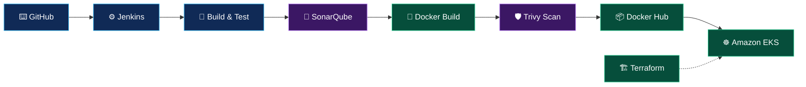

from pathlib import Path

readme = r'''<!-- ==========================================================
     OM KUTE | CLOUD & DEVOPS ENGINEER
     Profile README — replace the contents of Om-Kute/Om-Kute
     ========================================================== -->

 

  

---

## ⚡ TECH STACK

<table>
<tr>
<td width="50%" valign="top">

### ☁️ CLOUD & INFRASTRUCTURE

`EC2` `S3` `IAM` `VPC` `RDS` `EKS`  
`Lambda` `DynamoDB` `CloudWatch` `Route 53`  
`EBS` `EFS` `ELB` `CloudFront` `CloudFormation`

</td>
<td width="50%" valign="top">

### 🐳 CONTAINERS & CI/CD

`Docker Compose` `Kubernetes` `Helm` `EKS`  
`Jenkins` `GitHub Actions` `Git` `GitHub`  
`SonarQube` `Trivy`

</td>
</tr>
<tr>
<td width="50%" valign="top">

### 🐧 SYSTEMS & SCRIPTING

`Linux` `Ubuntu` `Shell Scripting` `Bash`  
`Python Fundamentals` `Process Management`  
`Permissions` `User Management` `Troubleshooting`

</td>
<td width="50%" valign="top">

### 🌐 NETWORKING & DATABASES

`TCP/IP` `DNS` `DHCP` `HTTP/HTTPS` `SSH`  
`Subnetting` `VPC` `Security Groups` `Load Balancing`

`MySQL` `MariaDB` `MongoDB` `Amazon RDS`  
`DynamoDB`

</td>
</tr>
</table>

---

## 🏆 FEATURED PROJECTS

---

## ♾️ CI/CD & DEVSECOPS PIPELINE

---

## 💼 EXPERIENCE

<b>DevOps Engineer Intern — Hisan Labs Pvt. Ltd.</b> &nbsp; | &nbsp; Mar 2026 – Nov 2026

- AWS infrastructure and services: EC2, S3, IAM and VPC
- Infrastructure provisioning with Terraform
- Linux administration and Bash scripting
- Docker containerization and Kubernetes deployment concepts
- Git, GitHub and Jenkins CI/CD workflows

## 🎓 EDUCATION & CERTIFICATIONS

| Education | Institute | Year |
|---|---|---|
| B.Tech — Computer Engineering | Bajaj Institute of Technology, Wardha | 2026 |

| Certification | Issuer |
|---|---|
| AWS Academy Graduate — Cloud Foundations | AWS Academy |
| AWS Academy Graduate — Cloud Developing | AWS Academy |
| Cloud and DevOps with AI Bootcamp | Exlearn Technologies |

---

## 📈 GITHUB ANALYTICS

 

 

---

## 🐍 CONTRIBUTION SNAKE

<picture>
  <source media="(prefers-color-scheme: dark)" srcset="https://raw.githubusercontent.com/Om-Kute/Om-Kute/output/github-snake-dark.svg"/>
  <source media="(prefers-color-scheme: light)" srcset="https://raw.githubusercontent.com/Om-Kute/Om-Kute/output/github-snake.svg"/>
  
</picture>

---

 

'''

out = Path("/mnt/data/README_om_kute_styled.md")
out.write_text(readme, encoding="utf-8")
print(f"Created {out} — {len(readme.splitlines())} lines")
