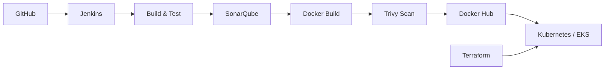

# 👋 Hi, I'm Om Kute

# ☁️ Cloud & DevOps Engineer

**AWS | Linux | Terraform | Docker | Kubernetes | CI/CD**

Building, automating and managing cloud infrastructure.

---

## 🚀 About Me

I'm a **Cloud & DevOps Engineer** with hands-on internship experience at **Hisan Labs Pvt. Ltd.**

I enjoy working with cloud infrastructure, Linux administration, containerization, infrastructure automation and CI/CD pipelines.

My technical interests include:

- ☁️ Building and managing infrastructure on AWS.
- 🏗️ Infrastructure as Code using Terraform.
- 🐳 Containerization using Docker.
- ☸️ Container orchestration using Kubernetes and Amazon EKS.
- ⚙️ Automating deployments using Jenkins and GitHub Actions.
- 🔐 Integrating security tools such as SonarQube and Trivy.
- 🐧 Linux administration and Shell scripting.

**Career Focus:** Cloud Engineering | DevOps | AWS | Site Reliability Engineering (SRE)

---

## 💼 Experience

**DevOps Engineer Intern — Hisan Labs Pvt. Ltd.**

`March 2026 – November 2026`

- Worked with AWS cloud infrastructure and services.
- Practiced infrastructure provisioning using Terraform.
- Worked with Linux administration and Bash scripting.
- Worked with Docker containers and Kubernetes deployments.
- Explored CI/CD automation using Git, GitHub and Jenkins.
- Worked with AWS IAM, EC2, S3 and VPC.

---

## 🛠️ Technical Skills

### ☁️ Cloud Platforms

**AWS Services:** EC2, S3, IAM, VPC, RDS, EKS, Lambda, DynamoDB, CloudWatch, Route 53, EBS, EFS, ELB, CloudFront.

### 🏗️ Infrastructure as Code

### 🐳 Containers & Orchestration

### ⚙️ CI/CD & DevSecOps

### 🐧 Operating Systems & Scripting

---

## 🚀 Featured Projects

### 1. AWS Serverless Event Processing Pipeline

**Technologies:** AWS Lambda | S3 | DynamoDB | IAM | CloudWatch | Python

- Built an event-driven architecture using Amazon S3 and AWS Lambda.
- Automated event processing using Python.
- Used DynamoDB for storing processed event data.
- Applied IAM permissions and CloudWatch monitoring.

🔗 [View Repository](https://github.com/Om-Kute/aws-serverless-event-processing-pipeline)

### 2. TravelEase – Cloud-Based Travel Booking System

**Technologies:** AWS | Linux | MySQL | Networking | Git

- Developed a cloud-based travel booking application.
- Applied cloud hosting and infrastructure concepts.
- Used Git and GitHub for source code management.

🔗 [View Repository](https://github.com/Om-Kute/TravelEase-Cloud-Based-Travel-Booking-System)

### 3. 100 Days of DevOps

**Technologies:** Linux | Networking | AWS | Docker | Kubernetes | Terraform

- Documenting my DevOps learning journey.
- Practicing Linux commands and Shell scripting.
- Exploring cloud infrastructure and containerization.
- Sharing practical commands, configurations and projects.

🔗 [View Repository](https://github.com/Om-Kute/100-days-devops)

---

## 🔄 My DevOps CI/CD Workflow

**Goal:** Automate application delivery while improving deployment consistency, security and reliability.

---

## 🏅 Certifications

- AWS Academy Graduate – Cloud Foundations.
- AWS Academy Graduate – Cloud Developing.
- Cloud and DevOps with AI Bootcamp – Exlearn Technologies.

---

## 🎓 Education

**B.Tech – Computer Engineering**

Bajaj Institute of Technology, Wardha | 2026

---

## 📊 GitHub Statistics

---

## 🐍 Contribution Activity

---

## 🎯 My DevOps Philosophy

> Automate repetitive tasks.  
> Build reliable infrastructure.  
> Secure every deployment.  
> Monitor everything.  
> Learn something new every day.

---

## 🤝 Let's Connect!

I'm interested in opportunities related to:

- Cloud Engineer
- DevOps Engineer
- AWS Cloud Engineer
- Linux Administrator
- Junior Site Reliability Engineer

📧 **Email:** [omkute40@gmail.com](mailto:omkute40@gmail.com)

💼 **LinkedIn:** [Connect with me](https://www.linkedin.com/in/om-kute-19b119270/)

💻 **GitHub:** [Explore my projects](https://github.com/Om-Kute)

### BUILD • AUTOMATE • DEPLOY • MONITOR • REPEAT 🚀

