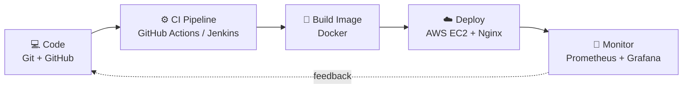

<!-- ================================================================ -->
<!--  OM KUTE • GITHUB PROFILE README                                  -->
<!--  Search for "EDIT:" to find every place you should personalise.   -->
<!-- ================================================================ -->

<div align="center">


<br><br>

<a href="https://www.linkedin.com/in/om-kute-19b119270/"></a>
<a href="mailto:omkute40@gmail.com"></a>
<a href="https://github.com/Om-Kute?tab=repositories"></a>

<br><br>


</div>

<br>

## `> whoami`

I'm a **DevOps & Cloud enthusiast** who cares about the full journey of an application: **source code → Linux server → container → cloud → pipeline → monitoring.**
I build small, real projects around each stage so I understand *why* things work, not just *how* to run the commands.

<table>
<tr>
<td width="50%" valign="top">

**🎯 Target roles**
- DevOps Engineer (Junior / Associate)
- Cloud Engineer
- Linux / Systems Administrator
- Site Reliability (learning path)

</td>
<td width="50%" valign="top">

**📍 Right now**
- 🔨 Building: end-to-end DevOps projects
- 📚 Deepening: AWS · Docker · CI/CD
- 🧭 Next up: Jenkins · Kubernetes · Terraform
- 📡 After that: Prometheus · Grafana

</td>
</tr>
</table>

---

## 🔁 How I Think About Delivery



<div align="center">

`UNDERSTAND → AUTOMATE → OPERATE → IMPROVE`

</div>

---

## ⚙️ Toolchain

<div align="center">


<br>


</div>

<br>

<!-- EDIT: adjust the status of each row honestly. Recruiters respect accuracy. -->

| Area | Tools | Status |
|---|---|---|
| **Operating Systems** | Linux (Ubuntu), Bash, SSH, systemd, permissions, networking | 🟢 Hands-on |
| **Version Control** | Git, GitHub, branching, pull requests | 🟢 Hands-on |
| **Cloud** | AWS: EC2, IAM, S3, VPC | 🟢 Hands-on |
| **Containers** | Docker: images, containers, volumes, networks | 🟢 Hands-on |
| **Web Servers** | Nginx: reverse proxy, static hosting | 🟢 Hands-on |
| **CI/CD** | GitHub Actions, Jenkins | 🟡 Building |
| **Orchestration & IaC** | Kubernetes, Terraform, Ansible | 🔵 Learning next |
| **Observability** | Prometheus, Grafana | 🔵 Learning next |

---

## 🧪 Featured Projects

<!-- EDIT: replace REPO_NAME_1..4 with your real repository names.
     These pin cards pull the repo description and language automatically. -->

<div align="center">

<a href="https://github.com/Om-Kute/REPO_NAME_1"></a>
<a href="https://github.com/Om-Kute/REPO_NAME_2"></a>
<a href="https://github.com/Om-Kute/REPO_NAME_3"></a>
<a href="https://github.com/Om-Kute/REPO_NAME_4"></a>

</div>

<br>

<!-- EDIT: fill in the real problem / outcome for each project.
     "Problem → Solution → Result" is what recruiters scan for. -->

<details open>
<summary><b>☁️ Cloud Deployment on AWS</b> &nbsp; <code>AWS</code> <code>EC2</code> <code>Linux</code> <code>Nginx</code></summary>
<br>

| | |
|---|---|
| **Problem** | Deploying an application manually to a server is slow and error-prone. |
| **What I built** | Provisioned an EC2 instance, secured it with IAM + security groups, configured Nginx as a reverse proxy, and deployed the app. |
| **Result** | `[EDIT: e.g. "App live on a public endpoint, deploy time cut from 30 min to 5 min"]` |
| **Repo** | [View repository →](https://github.com/Om-Kute?tab=repositories) |

</details>

<details>
<summary><b>🐳 Containerised Application</b> &nbsp; <code>Docker</code> <code>Nginx</code> <code>Linux</code></summary>
<br>

| | |
|---|---|
| **Problem** | "Works on my machine" environments that can't be reproduced. |
| **What I built** | Dockerised the app with a clean Dockerfile, persistent volumes and a networked Nginx front end. |
| **Result** | `[EDIT: e.g. "One-command setup: docker compose up", image size reduced by X%]` |
| **Repo** | [View repository →](https://github.com/Om-Kute?tab=repositories) |

</details>

<details>
<summary><b>⚙️ CI/CD Pipeline Automation</b> &nbsp; <code>GitHub Actions</code> <code>Jenkins</code> <code>Docker</code></summary>
<br>

| | |
|---|---|
| **Problem** | Manual build, test and release steps slow teams down and introduce mistakes. |
| **What I built** | An automated workflow that builds, tests and deploys on every push. |
| **Result** | `[EDIT: e.g. "Zero-touch deploys on merge to main"]` |
| **Repo** | [View repository →](https://github.com/Om-Kute?tab=repositories) |

</details>

<details>
<summary><b>🐧 Linux Administration Lab</b> &nbsp; <code>Bash</code> <code>SSH</code> <code>systemd</code> <code>Nginx</code></summary>
<br>

| | |
|---|---|
| **Problem** | Repetitive server tasks done by hand. |
| **What I built** | Bash scripts for user management, log handling, backups and service health checks. |
| **Result** | `[EDIT: e.g. "Automated 6 recurring admin tasks"]` |
| **Repo** | [View repository →](https://github.com/Om-Kute?tab=repositories) |

</details>

---

## 📊 GitHub Activity

<div align="center">


<br>


<br>


</div>

---

## 🗺️ Learning Roadmap

- [x] Linux fundamentals, Bash scripting, SSH
- [x] Git & GitHub workflows
- [x] AWS core services (EC2, IAM, S3, VPC)
- [x] Docker & containerisation
- [ ] CI/CD with GitHub Actions & Jenkins &nbsp; `← in progress`
- [ ] Infrastructure as Code with Terraform
- [ ] Configuration management with Ansible
- [ ] Kubernetes
- [ ] Monitoring with Prometheus & Grafana
- [ ] Cloud certification `[EDIT: e.g. AWS Cloud Practitioner / Solutions Architect Associate]`

---

## 🐍 Contribution Snake

<div align="center">

<picture>
  <source media="(prefers-color-scheme: dark)" srcset="https://raw.githubusercontent.com/Om-Kute/Om-Kute/output/github-snake-dark.svg">
  <source media="(prefers-color-scheme: light)" srcset="https://raw.githubusercontent.com/Om-Kute/Om-Kute/output/github-snake.svg">
  
</picture>

</div>

---

## 🧠 Engineering Principles

<table>
<tr>
<td align="center" width="20%">⚙️<br><b>Automate</b><br><sub>what repeats</sub></td>
<td align="center" width="20%">🏗️<br><b>Standardise</b><br><sub>what you build</sub></td>
<td align="center" width="20%">📡<br><b>Observe</b><br><sub>what matters</sub></td>
<td align="center" width="20%">🔧<br><b>Debug</b><br><sub>the root cause</sub></td>
<td align="center" width="20%">🚀<br><b>Improve</b><br><sub>every deployment</sub></td>
</tr>
</table>

<div align="center">


</div>

---

## 🤝 Let's Connect

<div align="center">

I'm actively looking for **DevOps / Cloud** opportunities. If you're hiring or want to collaborate, I'd love to hear from you.

<br>

<a href="mailto:omkute40@gmail.com"></a>
<a href="https://www.linkedin.com/in/om-kute-19b119270/"></a>
<a href="https://github.com/Om-Kute"></a>

<br><br>

```bash
$ git add .
$ git commit -m "keep learning"
$ git push origin future
```

<sub>`BUILD • AUTOMATE • DEPLOY • OBSERVE • REPEAT`</sub>

</div>


